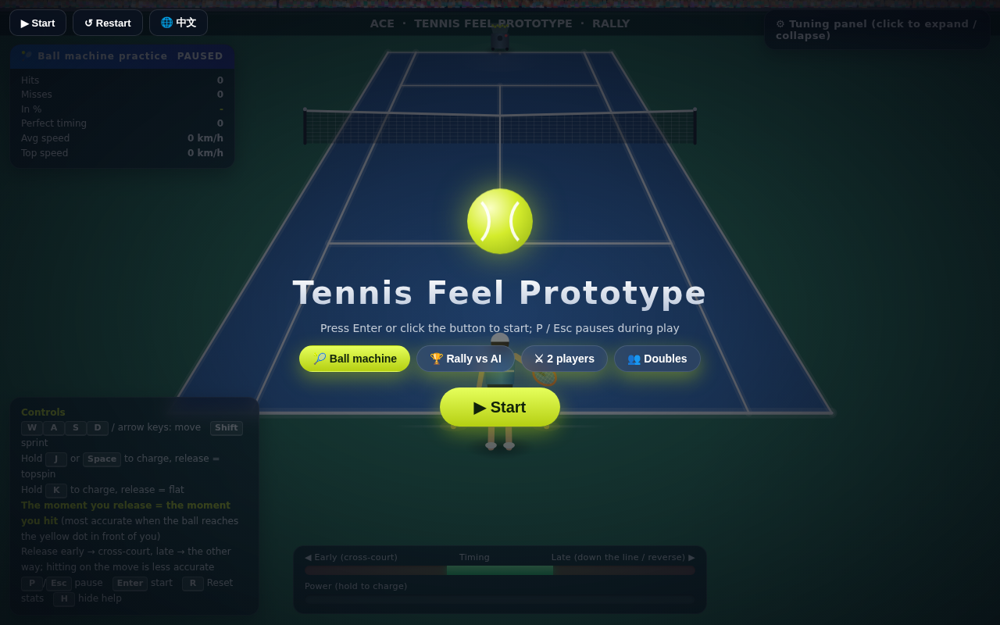
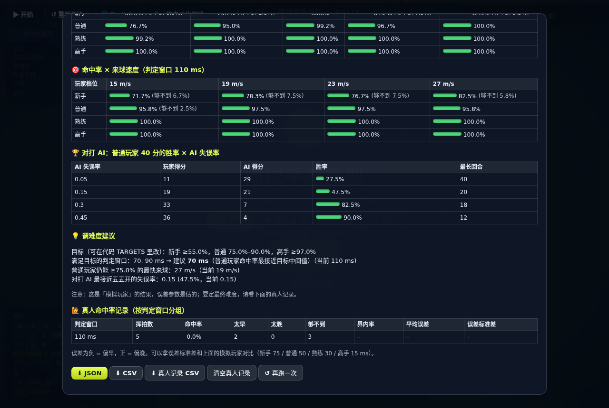

# Tennis Feel Prototype · 网球手感原型

[English](#english) · [中文](#中文)

**▶ Play online / 在线试玩:** `https://<your-github-username>.github.io/tennis-feel-prototype/`  <!-- replace after enabling GitHub Pages / 开通 GitHub Pages 后替换 -->



---

## English

A greybox tennis prototype that tests one question: **does hitting a ball feel good when timing, angle, footwork, power and spin all matter?** It is a single HTML file with no engine and no dependencies. Open it in Chrome, Safari, Edge or Firefox and play.

### How to play

| Action | Keys |
|---|---|
| Move | `W` `A` `S` `D` / arrow keys, `Shift` to sprint |
| Topspin | Hold `J` / `Space` to charge, **release to hit** |
| Flat | Hold `K` to charge, release to hit |
| Pause / start / reset stats | `P` or `Esc` / `Enter` / `R` |
| Language | 🌐 button, top-left (English by default, remembered) |

**The release is the hit.** Release early and the ball goes cross-court; release late and it goes the other way. Hitting while running is less accurate and slower. Flat shots above ~70% charge tend to go long, and weak shots find the net. Topspin can be hit at full power and still drop in, but it travels slower.

Modes: **Ball machine**, **Rally vs AI**, **2 players** (same keyboard: P1 `WASD` + `F`/`G`, P2 arrows + `.`/`/`) and **Doubles**. The tuning panel (top-right) exposes 13 parameters, such as hit window, ball speed and move speed, plus slow motion and a bot demo.

### One-click automated test

Click **🧪 One-click auto test** in the game, or run it from the command line:

```bash
npm install && npx playwright install chromium
npm test                  # desktop Chrome
npm run test:mobile       # Pixel 7 screen + 4x CPU throttle (approximates a mid-range phone)
```

The command line exits with code 1 on any FAIL, so it can run in CI. Reports (JSON, CSV and a screenshot) go to `autotest-results/`.

- **7 checks:** pause stops time, same seed gives the same result (determinism), score consistency, expert hit rate, average FPS, 1% low FPS, no JS errors.
- **Performance:** live FPS and per-frame JS time. A 10-minute battery soak measures battery drain per hour (Android Chrome only, because iOS Safari has no Battery API).
- **Difficulty tuning:** 4 simulated players (Beginner, Casual, Skilled, Expert) with different timing and positioning error, swept across hit windows, ball speeds and AI error rates. Real human shots are logged too, so the difficulty can be set from real data.



### What the data said

- Desktop: 7/7 checks pass at 60 fps.
- The default 110 ms hit window is **too easy**: the Casual player hits 99%. 70–90 ms meets the difficulty targets.
- Ball speed barely changes the hit rate, because footwork reach is too generous. That is the next thing to tune.
- An AI error rate of 0.15 gives roughly a 50/50 rally (47.5%), so that default stays.
- An emulated Pixel 7 runs at only 37 fps, yet JS takes just 0.6–3 ms per frame. The bottleneck is likely drawing the high-DPI canvas. This was measured on a GPU-less server and **still needs confirming on a real phone**.

### Test documentation

| Document | What it covers |
|---|---|
| [Test strategy (EN)](docs/test-strategy.en.md) · [测试策略（中文）](docs/test-strategy.zh.md) | Risk-based scope, 6 test levels, device matrix, entry/exit criteria, defect severity, regression checklist |
| [Test cases (EN)](docs/test-cases.en.md) | 90 game-specific cases across 14 areas (timing, physics, input, pause, multiplayer, i18n…) |
| [Automated test guide (中文)](docs/autotest-guide.zh.md) | How to run the automated test, check thresholds, how hit rates are measured |

### Decisions and trade-offs

- **Fixed 240 Hz physics step**, so hit judgement is identical on 60 Hz and 144 Hz screens and fast balls never tunnel through the racket or net.
- **Aim by simulation:** to land a ball on a target, the game runs the same physics function and binary-searches the launch angle, so the predicted and actual landing spots always match.
- **Speed is not a separate input.** It comes from power and timing, which keeps the controls to move + one button.
- **Mobile touch controls were tried and dropped.** They passed emulator checks but felt worse than the keyboard in play. The attempt is kept in [`experiments/mobile-touch/`](experiments/mobile-touch/).

### Known limitations

- Key timing is sampled per frame, so it can be up to ~16 ms off.
- Line calls use the ball centre, not its edge.
- No 15-30-40 scoring yet. In 2-player mode, P2 is small at the far end of the court.
- Not yet tested on real phones. Simulated-player error values are estimates; final difficulty should come from human play data.

### Repository layout

```
index.html                    the game (single file, no dependencies)
tests/run-autotest.js         command-line runner for the automated test (Playwright)
docs/                         test strategy, test cases, automated test guide, screenshots
experiments/mobile-touch/     dropped phone-browser control experiment
package.json  .gitignore
```

---

## 中文

一个灰盒网球原型，只想验证一件事：**时机、角度、脚步、力量、旋转都起作用的时候，击球手感好不好。** 单个 HTML 文件，不用游戏引擎、没有任何依赖，用 Chrome / Safari / Edge / Firefox 打开就能玩。

### 怎么玩

| 操作 | 按键 |
|---|---|
| 移动 | `W` `A` `S` `D` / 方向键，`Shift` 冲刺 |
| 上旋 | 按住 `J` / 空格蓄力，**松开就是击球** |
| 平击 | 按住 `K` 蓄力，松开击球 |
| 暂停 / 开始 / 重置统计 | `P` 或 `Esc` / `Enter` / `R` |
| 语言 | 左上角 🌐 按钮（默认英文，会记住选择） |

**松开的那一刻就是击球时刻。** 早松打斜线，晚松往反方向打；边跑边打更不准、球速更慢。平击蓄力超过约 70% 容易出界，力量太小会下网；上旋满力也能压进底线，但球速更慢。

模式：**发球机**、**对打 AI**、**双人对战**（同一键盘：P1 `WASD` + `F`/`G`，P2 方向键 + `.`/`/`）、**双打**。右上角调参面板有 13 个参数（判定窗口、来球速度、移动速度等），另有慢动作和机器人演示。

### 一键自动化测试

在游戏里点「🧪 一键自动化测试」，或者用命令行跑：

```bash
npm install && npx playwright install chromium
npm test                  # 电脑 Chrome
npm run test:mobile       # Pixel 7 屏幕 + CPU 降速 4 倍（模拟中端手机）
```

命令行有 FAIL 时退出码为 1，可以直接放进 CI；报告（JSON、CSV、截图）写到 `autotest-results/`。

- **7 项检查：** 暂停后时间不走、同种子结果可复现、计分自洽、高手命中率、平均帧率、1% 低帧、无 JS 报错。
- **性能：** 实时帧率和每帧 JS 耗时；10 分钟耗电测试算每小时掉电（只有安卓 Chrome 支持，iOS Safari 没有电池接口）。
- **调难度：** 4 档模拟玩家（新手 / 普通 / 熟练 / 高手），时机误差和站位误差不同，扫不同判定窗口、来球速度、AI 失误率；真人打的每一拍也会记录，用真实数据定难度。

### 数据结论

- 电脑上 7/7 项通过，60 fps。
- 默认 110ms 判定窗口**偏简单**（普通玩家命中 99%），70–90ms 符合难度目标。
- 来球速度对命中率几乎没影响，因为脚步覆盖范围太宽松，这是下一步要调的。
- AI 失误率 0.15 时对打差不多五五开（47.5%），保留默认值。
- 模拟 Pixel 7 只有 37 fps，但 JS 每帧只要 0.6–3ms，瓶颈应该是高分辨率画布的绘制。这是在没有 GPU 的服务器上测的，**还要在真手机上确认**。

### 测试文档

| 文档 | 内容 |
|---|---|
| [测试策略（中文）](docs/test-strategy.zh.md) · [Test strategy (EN)](docs/test-strategy.en.md) | 按风险定范围、6 个测试层级、设备矩阵、准入准出、缺陷分级、回归清单 |
| [测试用例 (EN)](docs/test-cases.en.md) | 14 个方面共 90 条游戏专项用例（时机、物理、输入、暂停、多人、多语言等） |
| [自动化测试说明（中文）](docs/autotest-guide.zh.md) | 怎么跑、各检查项的通过标准、命中率怎么算 |

### 设计决定和取舍

- **物理固定每秒 240 步**，所以 60Hz 和 144Hz 屏幕判定一样，高速球也不会穿过球拍或球网。
- **用模拟反推瞄准：** 要把球打到指定落点，就用同一个物理函数模拟、二分法反推出手角度，预测落点和实际落点一定一致。
- **速度不单独做输入**，由力量和时机算出来，操作只需要移动 + 一个键。
- **试过手机触屏操作，最后没采用：** 模拟器测试通过，但实际上手不如键盘好操作。尝试版本保留在 [`experiments/mobile-touch/`](experiments/mobile-touch/)。

### 已知局限

- 按键时间按帧取，最多差约 16ms。
- 压线判定只看球心，不看球的边缘。
- 还没有 15-30-40 计分；双人模式下 P2 在远端画面里很小。
- 还没在真手机上测过；模拟玩家的误差参数是估的，最终难度要用真人数据来定。

### 文件结构

```
index.html                    游戏本体（单文件，无依赖）
tests/run-autotest.js         一键自动化测试的命令行脚本（Playwright）
docs/                         测试策略、测试用例、自动化测试说明、截图
experiments/mobile-touch/     放弃的手机浏览器操作实验版
package.json  .gitignore
```
