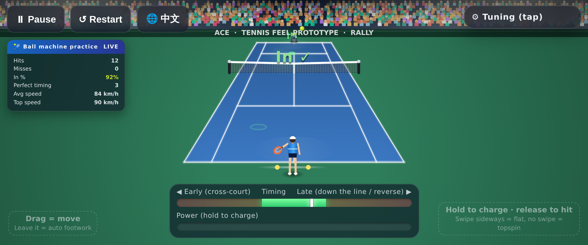

# Mobile touch experiment / 手机触屏实验版

**EN** — An earlier branch of the prototype with phone-browser controls: hold the right side of the screen to charge and release to hit (swipe sideways before release = flat), drag on the left side to move, auto-positioning when the left side is untouched, landscape lock prompt and auto-pause on background. It passed 35/35 checks on emulated iPhone 14 and Pixel 7 (landscape), but in hands-on play the touch controls felt worse than keyboard, so the main build stays desktop-first. This version does not include the one-click automated test. Try it on a desktop by adding `?touch=1` to the URL.

**中文** — 原型的一个早期分支，改成了手机浏览器操作：右边按住蓄力、松手击球（松手前横划 = 平击），左边拖动移动，不碰左边自动跑位，竖屏提示横过来，切后台自动暂停。在 iPhone 14 / Pixel 7 横屏模拟器上 35/35 项通过，但实际上手触屏不如键盘好操作，所以主版本保留电脑网页版。这个版本不含一键自动化测试。电脑上在网址后加 `?touch=1` 可用鼠标试。

